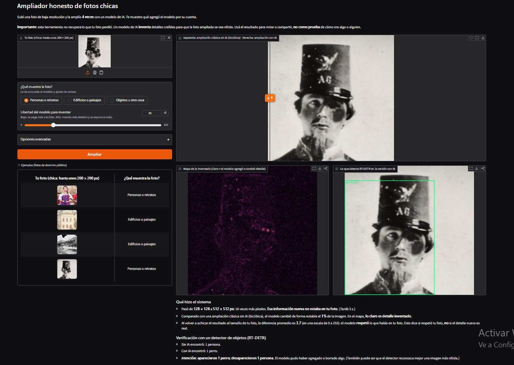
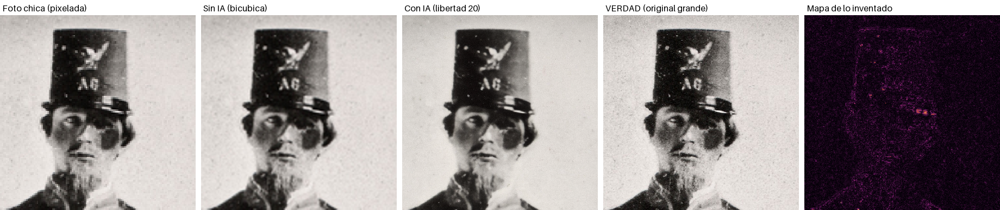
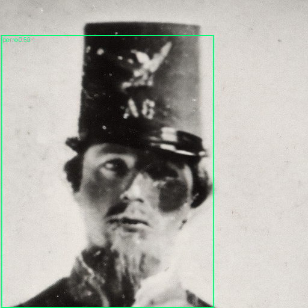
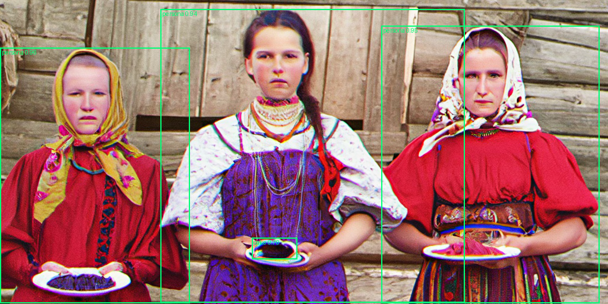
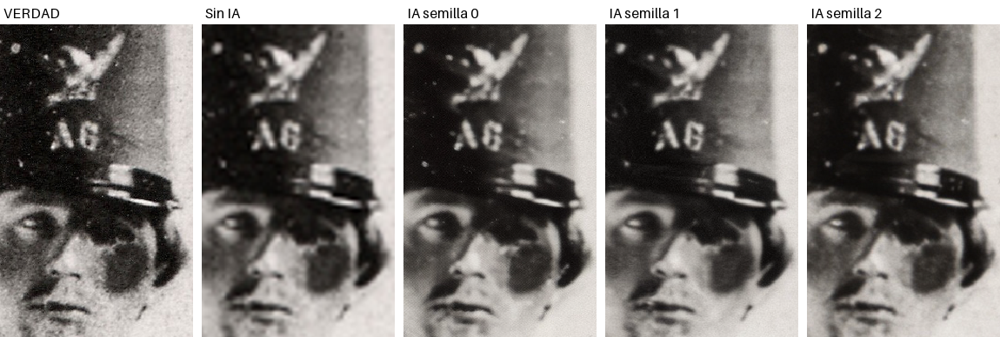

# Ampliador honesto de fotos chicas

> Amplía 4 veces una foto de baja resolución con un modelo de difusión y muestra qué detalles **inventó** la IA.



## Descripción

Cuando una foto es chica, la información que le falta **no existe más**. Las herramientas de "mejorar foto" con IA no la recuperan: la **inventan** de forma creíble. El resultado se ve nítido y convincente, pero una cara, una letra o una ventana pueden no ser las verdaderas.

Esta app amplía la foto con el modelo de difusión `stabilityai/stable-diffusion-x4-upscaler` y, al lado, hace lo que haría un método clásico sin IA (interpolación bicúbica). Comparando las dos muestra **dónde el modelo agregó detalle propio**, verifica con un detector de objetos (RT-DETR) que no hayan aparecido o desaparecido cosas, y marca el archivo descargado como "Ampliada con IA".

Lo que la diferencia de un "mejorador de fotos" común: no promete recuperar nada, y le da a la persona herramientas para saber **en qué partes de la imagen confiar menos**.

## Persona usuaria

<!-- PENDIENTE (Horacio): completar con tu persona. La consigna pide definirla vos. -->

**Nombre**: _[completar]_
**Contexto**: _[completar]_
**Problema**: _[completar]_
**Solución**: _[completar]_

## Demo

<!-- PENDIENTE: link al video de 5 minutos (que se abra sin iniciar sesión) -->
Video: _[link]_

## Qué es real y qué es inventado

**Qué hace el modelo.** Recibe la foto chica y genera una 4 veces más grande que, al achicarla, se parece a la original. Todo lo que está por debajo del tamaño de la foto original (poros, pestañas, letras chicas, ornamentos) es una **suposición** del modelo, aprendida de millones de otras imágenes. La forma general y los colores sí vienen de la foto: eso se comprueba achicando el resultado y comparándolo con la entrada (la app lo muestra como "coherencia").

**Cómo lo comprobamos.** Para los ejemplos usamos fotos de las que tenemos el **original grande** (la verdad). Las achicamos a propósito, las ampliamos con la app y comparamos (`scripts/generar_evidencias.py`, corrido en Colab con una T4):



La versión con IA **se ve** más nítida que la bicúbica, pero **se parece menos a la verdad** en las cuatro fotos (PSNR más bajo, ver tabla abajo). El detalle nítido es inventado, no recuperado.

**Ejemplo concreto donde el modelo se equivocó: el retrato que pasó a ser un perro.** En la ampliación clásica, RT-DETR detecta **1 persona**. En la ampliación con IA de la misma foto, detecta **1 perro** (confianza 0,59). El modelo de difusión cambió la textura de la cara, el pelo y la barba lo suficiente como para que otro modelo de IA ya no reconozca a una persona. A simple vista sigue siendo un hombre: el cambio no se nota mirando, se nota midiendo.



Otros dos casos del mismo tipo: en la foto de las tres jóvenes aparece una **"torta" (cake)** donde hay un plato con frutos, y en el edificio aparece un **reloj** sobre una ventana. Ninguno de esos objetos se detecta en la versión sin IA.



Algo más sutil: en el retrato, la **mancha oscura sobre el ojo** es daño de la placa original, no parte de la cara. El modelo no lo sabe: la amplía con la misma nitidez que el resto, como si fuera piel. Y con tres semillas distintas, el modelo dibuja tres versiones apenas distintas de la cara y de las letras "AG" del sombrero: si fuera información recuperada, saldría siempre igual.



**Cómo se ve en la app.**
- Comparador con deslizador: izquierda sin IA (bicúbica), derecha con IA.
- **Mapa de lo inventado**: resta píxel a píxel entre las dos ampliaciones; lo claro es lo que agregó el modelo.
- **Detecciones con y sin IA**, con un aviso cuando aparece o desaparece algo.
- Control de **libertad para inventar** (`noise_level`) y **semilla**.
- Aviso fijo arriba de todo y aviso específico según el tipo de foto (caras, edificios).

En la app (captura de arriba) el informe lo dice explícitamente: *"Atención: aparecieron 1 perro; desaparecieron 1 persona."*

**Advertencia a la persona usuaria.** "Esta herramienta no recupera lo que tu foto perdió. Un modelo de IA inventa detalles creíbles. Usá el resultado para mirar o compartir, no como prueba de cómo era algo o alguien." El archivo descargado lleva una franja visible y metadatos que dicen "Ampliada con IA".

**Cómo verificar.** Con una fuente independiente: otra foto de la misma persona o lugar, un documento, alguien que estuvo ahí. En los ejemplos de este repo se pudo porque tenemos el original grande; con una foto real chica **no hay verdad contra la cual comparar**, y el resultado no pasa de "creíble".

## Características

- Ampliación 4x con difusión (`stable-diffusion-x4-upscaler`).
- Línea base clásica (bicúbica) en la misma pantalla.
- Mapa de lo inventado y porcentaje de la imagen que cambió.
- Medida de coherencia: ¿el resultado, achicado, sigue siendo tu foto?
- Verificación con RT-DETR: personas y objetos detectados con y sin IA.
- Descarga con aviso visible y en metadatos.
- Mensajes de error y de progreso en lenguaje simple.

## Tecnologías utilizadas

**Entorno:** Python 3.12, uv

**Interfaz:** Gradio 6.32.0

**Modelos de IA:**
- `stabilityai/stable-diffusion-x4-upscaler` (licencia CreativeML Open RAIL++-M) — ampliación 4x por difusión.
- `PekingU/rtdetr_r50vd` (Apache 2.0) — detección de objetos para verificar.

**Procesamiento:** PyTorch 2.10.0, diffusers 0.43.0, transformers 5.23.0, Pillow, NumPy.

**Hardware con el que se probó:**
- Google Colab, GPU NVIDIA Tesla T4 (15 GB de VRAM), PyTorch 2.10.0 + CUDA 12.8. Entre 4 y 9 segundos por ampliación (20 pasos), según el tamaño de la foto.
- Computadora de desarrollo: _[confirmar modelo y RAM]_, sin GPU dedicada (no alcanza para correr el modelo de difusión en tiempo razonable; por eso Colab).

## Arquitectura del sistema

```
Persona usuaria
   │  sube una foto chica, elige tipo de foto y libertad
   ▼
Interfaz Gradio (app.py)
   │
   ├─► preparar_entrada: RGB, achica si es grande, lados múltiplos de 8   (src/diffusion.py)
   │
   ├─► bicúbica x4  ──────────────┐  línea base sin IA                  (src/honesty.py)
   ├─► difusión x4 (upscaler) ────┤  detalle inventado                  (src/diffusion.py)
   │                              ▼
   ├─► mapa de diferencias + coherencia                                  (src/honesty.py)
   ├─► RT-DETR sobre bicúbica y sobre difusión → qué apareció/desapareció (src/analysis.py)
   │
   ▼
Comparador · mapa · detecciones · informe en lenguaje simple · descarga con aviso
```

Los modelos se cargan una sola vez, al iniciar la app.

## Instalación y ejecución

### Requisitos
- Python 3.12 y [uv](https://docs.astral.sh/uv/) (uv baja Python 3.12 solo si no lo tenés).
- GPU NVIDIA con 6 GB de VRAM o más. Sin GPU funciona, pero tarda varios minutos por foto: usá Colab.
- No hace falta token de Hugging Face.

### Pasos

```bash
git clone https://github.com/hbarrabasqui/tpi2-ampliador.git
cd tpi2-ampliador
uv sync
uv run app.py
```

La primera vez se descargan los modelos (unos 3 GB). Después se abre en http://127.0.0.1:7860

Verificación rápida sin descargar modelos: `uv run python tests/verificar.py`

### Alternativa: Google Colab

Abrí [`colab/ejecutar_en_colab.ipynb`](colab/ejecutar_en_colab.ipynb) en Colab, elegí **T4 GPU** y ejecutá las celdas en orden. La última levanta la app con `uv run app.py` y muestra un link público `https://....gradio.live`.

## Uso

1. Abrí la app.
2. Subí una foto chica o elegí un ejemplo.
3. Indicá qué muestra la foto y cuánta libertad le das al modelo.
4. Tocá **Ampliar**.
5. Mové el deslizador del comparador, mirá el mapa de lo inventado y leé el informe.
6. Descargá el resultado (lleva la leyenda "Ampliada con IA").

La captura del principio muestra la app después de ampliar el retrato de ejemplo en Colab (T4): la ampliación tardó 5 segundos.

## Decisiones de diseño

### Por qué Gradio
Es el estándar para demos de modelos de Hugging Face, trae un comparador con deslizador (`ImageSlider`) y en Colab da un link público sin configurar nada.

### Por qué `stable-diffusion-x4-upscaler`
Es el modelo de difusión de super-resolución que propone la consigna, no requiere aceptar licencia ni token, y entra en una T4 gratuita con imágenes chicas (hasta unos 40.000 píxeles). Su parámetro `noise_level` funciona como un control natural de "cuánto puede inventar".

### Por qué RT-DETR, y por qué contra la bicúbica
Para la persona usuaria es más útil saber "¿apareció o desapareció alguien?" que un puntaje abstracto de nitidez. El detector se aplica a la ampliación clásica y a la ampliación con IA: tienen el mismo tamaño y salen de la misma foto, así que si las detecciones cambian, el cambio lo introdujo el modelo. Límite: el detector confirma que hay una persona, no que la cara sea la de esa persona.

### Por qué el mapa compara contra la bicúbica y no contra la foto original
La persona usuaria no tiene un original grande. La bicúbica representa "ampliar sin inventar"; lo que la difusión agrega por encima de eso es, justamente, lo inventado.

### Por qué PyTorch 2.10.0 fijo
Es la última versión publicada en PyPI compilada para CUDA 12.8. Las siguientes usan CUDA 13, que necesita drivers de GPU más nuevos y podría no funcionar en Colab.

### Principios de Human-AI Interaction aplicados

**Transparencia**: la app dice qué hace en cada paso ("Ampliando con el modelo de difusión (inventa detalle plausible)...") y muestra lo que haría un método sin IA al lado.
**Control**: libertad para inventar, semilla, tipo de foto, y comparador con deslizador.
**Explicabilidad**: informe en lenguaje simple: cuántos píxeles nuevos hay, qué porcentaje cambió el modelo, si respetó la foto, qué detectó.
**Honestidad sobre lo generado**: nunca dice "recuperar"; aviso fijo, avisos por tipo de foto, mapa de lo inventado y leyenda en el archivo exportado.
**Manejo de errores**: mensajes como "La foto pesa 15 MB. Probá con una de menos de 10 MB." o "No pude leer ese archivo como imagen. Probá con un JPG o PNG."

## Conceptos de procesamiento digital aplicados

- **Muestreo y resolución espacial**: la foto chica tiene 16 veces menos muestras que el resultado; ese detalle no se puede reconstruir sin suponer.
- **Interpolación**: vecino más cercano (para mostrar la foto pixelada), bicúbica (línea base), Lanczos (para achicar sin aliasing al preparar ejemplos y medir coherencia).
- **Aliasing**: por eso se achica con Lanczos y no descartando píxeles.
- **Operaciones aritméticas entre imágenes**: resta absoluta píxel a píxel para el mapa de diferencias; umbral para contar píxeles con cambio notable.
- **Espacio de color RGB**: la diferencia se promedia entre los tres canales.
- **Pseudocolor**: el mapa de diferencias usa una paleta de calor para que se vea dónde cambió más.
- **Ruido**: el upscaler suma ruido gaussiano a la entrada (`noise_level`) y lo va quitando; más ruido, más invención.
- **Métricas de calidad**: PSNR contra la verdad en `scripts/generar_evidencias.py` (mide parecido, no autenticidad).

## Uso de agentes de IA

- **Herramienta:** Claude (Anthropic), modelo Opus 5.5, trabajando sobre el repositorio.
- **Qué decidí yo:** <!-- PENDIENTE (Horacio): revisar y completar con tus palabras --> la sub-tarea (super-resolución), ejecutar en Colab por no tener GPU, la persona usuaria, _[completar]_.
- **Qué propuso el agente y cómo lo revisé:** la estructura del código, comparar contra la bicúbica (y no contra el original) para el mapa y el detector, fijar PyTorch 2.10.0, la medida de coherencia, el script de evidencias con la verdad. _[completar: cómo lo revisaste]_
- **Qué descarté y por qué:** _[completar]_
- El agente no pudo descargar los modelos en su entorno: las pruebas con modelos reales las corrí yo en Colab y el agente leyó los resultados desde mi Drive.

## Limitaciones conocidas

- Funciona mejor con fotos chicas (de 64 a 256 px de lado, hasta unos 40.000 píxeles, por ejemplo 200 × 200). Las más grandes se achican antes de procesar.
- Tiempo de procesamiento: entre 4 y 9 segundos por foto en una T4 de Colab; en CPU, varios minutos.
- **Caras, letras y números**: el modelo los inventa. No sirve para identificar personas ni leer textos.
- El detector RT-DETR solo conoce 80 tipos de objetos y también se equivoca: un cambio en las detecciones es una señal para mirar con atención, no una prueba de qué cambió.
- La medida de coherencia dice si el modelo respetó la foto, no si el detalle nuevo es verdadero.
- Las frases que guían al modelo están en inglés porque su codificador de texto se entrenó así.

## Métricas de calidad

En `scripts/generar_evidencias.py` se calcula el **PSNR** (parecido píxel a píxel) de la bicúbica y de la difusión contra el original grande. Es habitual que la bicúbica tenga **mejor** PSNR aunque la difusión **se vea** más nítida: el detalle que agrega el modelo no coincide con el real. Las métricas miden parecido, no verdad.

Resultados de `scripts/generar_evidencias.py` en Colab (T4), con libertad 20 y semilla 0:

| Ejemplo | PSNR bicúbica vs verdad (dB) | PSNR IA vs verdad (dB) | Coherencia IA (0-255) | % cambiado vs bicúbica | Detecciones sin IA | Detecciones con IA |
|---|---|---|---|---|---|---|
| caras_kirillov_1909 | 24,7 | 19,4 | 12,4 | 25 % | 3 personas | 3 personas, 1 torta |
| edificio_perm_1910 | 23,0 | 21,0 | 5,8 | 20 % | nada | 1 reloj |
| retrato_1860 | 29,9 | 28,2 | 3,7 | 1 % | 1 persona | 1 perro |
| puente_1888 | 23,4 | 22,2 | 4,2 | 13 % | nada | nada |

En las cuatro fotos la bicúbica queda **más cerca de la verdad** que la difusión. El retrato es el caso más llamativo: el modelo cambió solo el 1 % de los píxeles de forma notable y eso alcanzó para que el detector viera un perro.

## Trabajo futuro

- [ ] Comparar con otro modelo de super-resolución.
- [ ] Explicación en lenguaje natural con un modelo de visión y lenguaje.
- [ ] Publicar en un Hugging Face Space.

## Reflexiones y aprendizajes

<!-- PENDIENTE (Horacio): 1 o 2 párrafos con tus palabras -->

## Recursos y referencias

- Modelo de difusión: https://huggingface.co/stabilityai/stable-diffusion-x4-upscaler
- RT-DETR: https://huggingface.co/PekingU/rtdetr_r50vd
- diffusers: https://huggingface.co/docs/diffusers/
- Materiales de la unidad "Modelos de difusión" (Matías Barreto, IFTS 24, 2026), cuadernos 03 y 05.
- Fotos de ejemplo: ver [assets/FUENTES.md](assets/FUENTES.md).

## Autor

**Horacio Barrabasqui**
Estudiante de Tecnicatura Superior en Ciencias de Datos e IA — IFTS 24
Materia: Procesamiento Digital de Imágenes e Introducción a Visión por Computadora
Año: 2026

GitHub: https://github.com/hbarrabasqui

## Licencia

Código: MIT (ver `LICENSE`). Los modelos mantienen sus licencias: CreativeML Open RAIL++-M (upscaler) y Apache 2.0 (RT-DETR). Las fotos de ejemplo son de dominio público.

---

**Trabajo Integrador N°2 - IFTS 24 - 2026**
